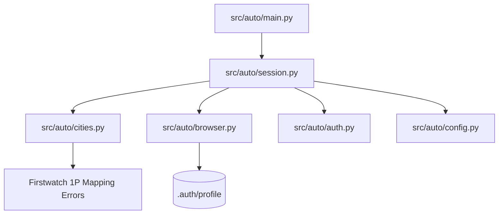

# Architecture: Firstwatch Automation

## Overview
`auto` is a modular, resilient Playwright automation client designed for [Firstwatch](https://firstwatch.dcluttr.ai/) to automatically process 1P City Mapping Errors.

## Core Components

### 1. Configuration (`src/auto/config.py`)
- Reads configuration from `.env` or system environment variables with resilient defaults.
- Default `base_url`: `https://firstwatch.dcluttr.ai/data/data-upload/1p-mapping-errors`.
- Default `post_resolve_delay`: `10.0` seconds.

### 2. Browser Management (`src/auto/browser.py`)
- Employs `launch_persistent_context` pointing to `.auth/profile`.
- Applies `playwright-stealth` evasion patches.

### 3. Authentication & Guard (`src/auto/auth.py`)
- Detects `/login` redirects and automatically completes the login form with credentials.

### 4. City Mapping Resolver (`src/auto/cities.py`)
- `select_cities_and_open_modal(page)`: Selects the Cities tab, verifies badge count, marks the select-all checkbox, and clicks Resolve all.
- `suggest_and_resolve(page, post_resolve_delay)`: Clicks Suggest with AI, polls for completion, clicks the enabled `Resolve N cities` button, and waits at least 10 seconds for backend mapping updates to settle.

### 5. Session Manager (`src/auto/session.py`)
- Coordinates the Playwright context and page lifecycle.
- Enforces a generous 3.0s delay after navigations.

### 6. Automated Runner (`src/auto/main.py`)
- Executes the workflow end-to-end and exits cleanly without waiting for interactive input.

## NASA JPL Rule 4 Compliance
Every production module and function fits on a single printed sheet (≤ 60 lines per file). Tests in `tests/` are exempt from file-length limits.
