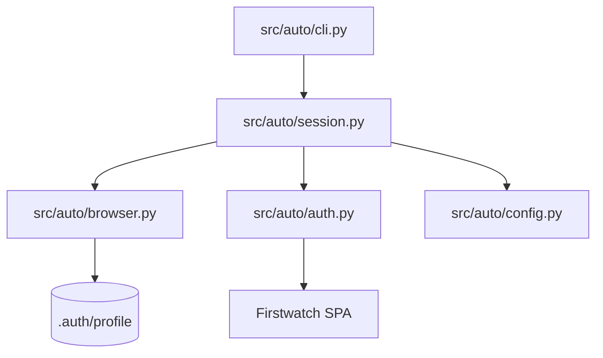

# Architecture: Firstwatch Automation

## Overview
`auto` is a modular, resilient Playwright automation client designed for [Firstwatch](https://firstwatch.dcluttr.ai/). It maintains persistent session state, avoids unexpected logouts, and provides an interactive headful CLI for page navigation.

## Core Components

### 1. Configuration (`src/auto/config.py`)
- Employs `python-decouple` to parse configuration from `.env` or system environment variables with resilient defaults.
- Key properties: `base_url`, `login_url`, `email`, `password`, `nav_delay` (3.0s), `profile_dir` (`.auth/profile`), and `headless` (False).

### 2. Browser Management (`src/auto/browser.py`)
- Uses `launch_persistent_context` to store browser state, cookies, and tokens in `.auth/profile`.
- Applies `playwright-stealth` evasion patches to mimic standard human browser interactions.

### 3. Authentication & Guard (`src/auto/auth.py`)
- `is_login_page(page)`: Detects redirection to `/login` or visibility of the email input.
- `login(page, settings)`: Automatically fills `#email`, `#password`, clicks `button[type="submit"]`, and pauses for the configured `nav_delay`.

### 4. Session Manager (`src/auto/session.py`)
- Wraps Playwright lifecycle and navigation.
- Guarantees a minimum 3.0-second delay on every navigation to allow client-side hydration.
- Automatically triggers `login` if the target page redirects to `/login`.

### 5. Interactive CLI (`src/auto/cli.py`)
- Keeps the headful browser alive and receives user input via an interactive command prompt.
- Supported commands: `goto <url>`, `reload`, `url`, and `exit`.

## NASA JPL Rule 4 Compliance
Every production module and function is designed to fit on a single printed sheet (≤ 60 lines per file). Tests in `tests/` are exempt from file-length limits.
