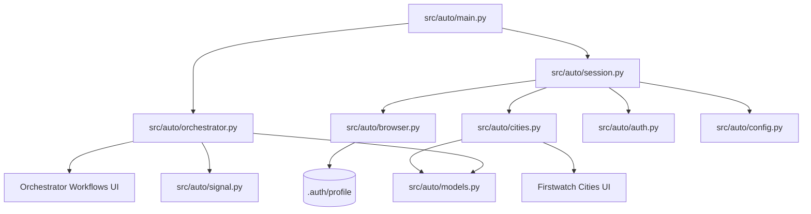

# Architecture: Firstwatch & Orchestrator Automation

## Overview
`auto` is a modular, resilient Playwright automation pipeline that bridges [Firstwatch](https://firstwatch.dcluttr.ai/) error resolution and [Orchestrator](https://orchestrator.dcluttr.ai/) workflow tracking and signal dispatch.

## Core Components

### 1. Configuration (`src/auto/config.py`)
- Reads configuration from `.env` or system environment variables with resilient defaults.
- Manages Firstwatch and Orchestrator target URLs, delays, and authentication timeouts.

### 2. Browser Management (`src/auto/browser.py`)
- Employs `launch_persistent_context` pointing to `.auth/profile`.
- Applies `playwright-stealth` evasion patches and preserves session cookies across both Firstwatch and Orchestrator.

### 3. Authentication & Guard (`src/auto/auth.py`)
- Detects `/login` redirects and automatically completes the login form with credentials.

### 4. Data Models (`src/auto/models.py`)
- `BrandItem`: Compact, typed dataclass tracking `brand` and `platform` extracted from Firstwatch.

### 5. City Mapping Resolver (`src/auto/cities.py`)
- `select_cities_and_open_modal(page)`: Selects the Cities tab, verifies badge count, marks the select-all checkbox, extracts selected `BrandItem` instances, and clicks Resolve all.
- `suggest_and_resolve(page, post_resolve_delay)`: Clicks Suggest with AI, polls for completion, clicks the enabled `Resolve N cities` button, and waits at least 10 seconds for backend mapping updates to settle.

### 6. Orchestrator Automation (`src/auto/orchestrator.py`)
- `handle_sso_if_needed(page, timeout)`: Detects SSO prompt and allows up to 60s for Google login.
- `select_per_page_500(page, delay)`: Switches result view to 500 items and waits for render.
- `find_and_click_workflow(page, brands)`: Scans workflow IDs top-to-bottom and clicks the first match for any extracted brand.
- Triggers signal dispatch via `send_workflow_signal` after workflow navigation.

### 7. Workflow Signal Dispatcher (`src/auto/signal.py`)
- `send_workflow_signal(page, signal_name, post_signal_delay)`: Opens the More Actions dropdown, selects Send a Signal, chooses `retry_upload`, and submits the signal modal.

### 8. Session Manager (`src/auto/session.py`)
- Coordinates the Playwright context and page lifecycle.
- Enforces navigation delays and returns extracted brands alongside resolved counts.

### 9. Automated Runner (`src/auto/main.py`)
- Executes the two-stage pipeline end-to-end and exits cleanly without waiting for interactive input.

## NASA JPL Rule 4 Compliance
Every production module and function fits on a single printed sheet (≤ 60 lines per file). Tests in `tests/` are exempt from file-length limits.
